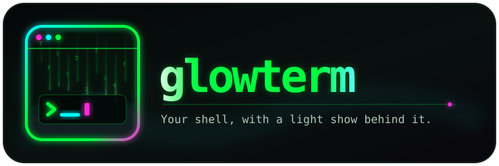

<p align="center"></p>

# glowterm

Your shell, with a light show behind it.

glowterm runs your normal shell inside a terminal window and paints an animation into the empty space behind the text: Matrix rain, an aurora, a neon city fly-through, self-playing retro games and more. You keep working as usual; the animation shows through wherever the screen is blank and dims itself behind lines of text so they stay readable.

```
glowterm                  # login shell over Matrix rain
glowterm -a cyberspace    # pick an animation
glowterm -- htop          # run something other than the shell
```

Press **Ctrl+]** to switch animation while it is running. Exit the shell to leave.

## Animations

| Name | What you see |
|---|---|
| `matrix` | Katakana digital rain: white-hot leading glyphs, fading green tails |
| `aurora` | Slow curtains of green, teal and violet rays |
| `fire` | Flames rising from the bottom edge |
| `starfield` | Stars streaming out from the centre, stretching into streaks |
| `plasma` | Drifting full-spectrum colour fields |
| `cyberspace` | A flight down the streets of a city of scrolling data towers |
| `nightride` | A neon skyline sliding past, with tail-light trails on the highway |
| `arcade` | Five original early-console-style games playing themselves |

`glowterm --list` prints this list. Ctrl+] cycles through them in this order.

## Install

glowterm is a single Rust program. You need a [Rust toolchain](https://rustup.rs) (edition 2024, so Rust 1.85 or newer).

```
git clone <this repository>
cd glowterm
cargo install --path .
```

That puts `glowterm` in `~/.cargo/bin`. To install the manual page as well:

```
mkdir -p ~/.local/share/man/man1
cp man/glowterm.1 ~/.local/share/man/man1/
```

glowterm was developed and tested on macOS in iTerm2. It uses only POSIX terminal facilities and should build on Linux, but that has not been tried. It does not support Windows.

## Using it

| Key or action | Effect |
|---|---|
| Ctrl+] | Next animation (its name flashes in the top-right corner) |
| Mouse wheel | Scroll back through earlier output; a marker such as `↑ 12/340` shows where you are |
| Any typing | Return to the prompt after scrolling |
| Option + drag (iTerm2) | Select text. glowterm holds the mouse so the wheel can scroll; in many other terminals the override key is Shift |
| `exit` | Leave glowterm and get your terminal back as it was |

The options you are most likely to want:

| Option | Default | Effect |
|---|---|---|
| `-a`, `--anim NAME` | `matrix` | Which animation to start with |
| `-i`, `--intensity N` | `1.0` | Overall animation brightness, 0 to 1 |
| `-t`, `--text-dim N` | `0.3` | Brightness kept behind lines of text; 0 clears them completely |
| `-d`, `--density N` | `1.0` | How busy the animation is |
| `-f`, `--fps N` | `20` | Frames per second, 1 to 60 |

The full list is in [docs/usage.md](docs/usage.md), in `glowterm --help`, and in the manual page.

## Things to know before you live in it

- **Text selection needs your terminal's override key held** (Option in iTerm2). Use `--no-mouse` to get plain selection back, at the cost of wheel scrolling.
- **Ctrl+] does not reach programs inside glowterm.** That is the escape key in `telnet` and "jump to tag" in vim. Use `--no-hotkey` to pass it through.
- **Your terminal's own scrollback does not apply.** glowterm redraws a fixed screen, so it keeps its own history (10,000 lines by default).
- **The built-in terminal emulation is simpler than a real terminal's.** Everyday programs (shells, vim, less, htop) work; inline images, hyperlinks, some newer keyboard protocols and the old line-drawing character set do not, so a few programs' borders show as letters.
- **It is a steady stream of output.** Animations send between about 3 KB/s and 1.1 MB/s to your terminal at 200×60. Lower `--fps` or `--density` if your terminal's CPU use bothers you.

[docs/usage.md](docs/usage.md) covers these in more detail, including tmux.

## Documentation

- [docs/usage.md](docs/usage.md): every option, behaviour in detail, troubleshooting
- [docs/how-it-works.md](docs/how-it-works.md): the design, for people reading or changing the code
- [docs/creating-animations.md](docs/creating-animations.md): how to write your own animated background
- [docs/code-review.md](docs/code-review.md): an independent review of the code and what came of it
- [man/glowterm.1](man/glowterm.1): the manual page
- [tldr/glowterm.md](tldr/glowterm.md): a tldr-pages style cheat sheet

## Similar projects

- [Tattoy](https://github.com/tattoy-org/tattoy): a text-based terminal compositor that can run GPU shaders behind your shell
- [termflux](https://github.com/tndoan/termflux): shell with starfield, matrix and fire backgrounds
- Ghostty's custom shaders: animated backgrounds drawn by the terminal itself

## Licence

MIT. See [LICENSE](LICENSE).
